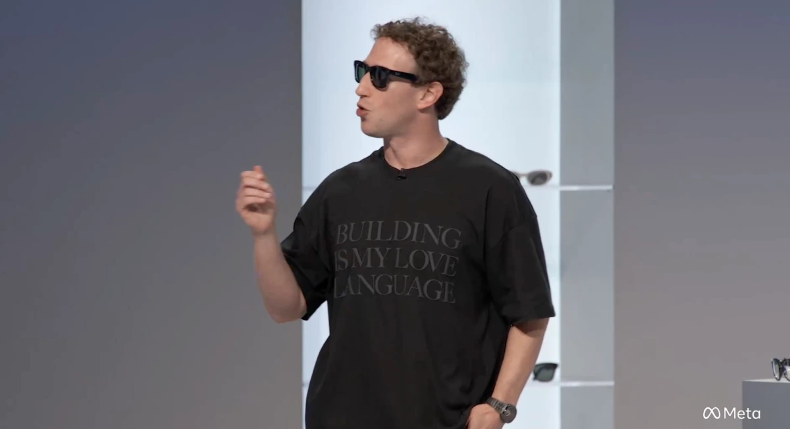

这几天 AI 编程赛道的新闻密度，说实话有点离谱。昨天 OpenAI 官宣收购代码托管工具公司 Pierre，我还没消化完"OpenAI 要摸 GitHub 老巢"这件事，Meta 紧跟着就确认收购了 AI 编程初创公司 Conductor。再叠加 Claude Code 产品负责人 Cat Wu 离职第二天就加入 OpenAI 的戏码，短短一周，三家巨头在同一块地皮上同时开工。

先说 Meta 这单。据 [TechCrunch 报道](https://techcrunch.com/2026/11/04/meta-acquires-ai-coding-startup-conductor/)，Meta 已确认收购成立于 2024 年的 Conductor，交易金额未披露。这家公司很有意思——它做的不是底层模型，而是一个让你在多个并行工作空间里同时部署 AI Agent 的平台：一个项目拆成几块，几个智能体各管一摊，云端、本地、手机上都能跑。值得注意的是，Conductor 调用的底层模型来自 Anthropic 和 OpenAI，也就是说，它本质上是站在两家头部模型厂商肩膀上做编排层的。

*图源：TechCrunch《Meta acquires AI coding startup Conductor》*

这个细节恰恰是 Meta 看中它的原因。Meta 自己的编程智能体 Muse Code 今年 8 月才推出，起步明显晚于 OpenAI 的 Codex 和 Anthropic 的 Claude Code，但增长不慢——官方披露 Muse 系列用户已突破 1000 万。买 Conductor 补的正是"多智能体并行协作"这一块短板。创始人 Charlie Holtz 在公告里说得很直白：团队将加入 Meta 超级智能实验室，跟首席 AI 官 Alexandr Wang 和产品负责人 Nat Friedman 一起，做"下一代交互界面"，明年年初有新东西。至于 Conductor 的老用户，云服务 11 月 20 日就关，本地版撑到明年年初——初创公司被收购后的标准剧本。

再看挖角这出戏。据[潮新闻梳理](https://tidenews.com.cn/news.html?id=3606442)，Cat Wu 是 Claude Code 的创始产品经理，2024 年加入 Anthropic 时它还只是个内部实验工具，她陪着这个产品走完了从研究预览到年化收入 25 亿美元的全过程。美西时间 11 月 3 日她官宣离开 Anthropic，一天后官宣加入 OpenAI，出任核心产品（Core Products）产品管理负责人。有人问她是不是要休息一阵，她回了三个词："post agi!"。

*图源：潮新闻《Claude Code 产品负责人离职次日加盟 OpenAI》*

我的判断是，这单挖角比收购 Pierre 更值得琢磨。技术可以买、可以攒，但"把模型能力翻译成企业愿意持续付费的产品"这条路径，目前全行业被验证过的次数屈指可数。JetBrains 今年 8 月的调查显示，全球 39% 的专业开发者在工作中用 Claude Code，Codex 只有 16%；Menlo Ventures 的报告估算，Claude Code 和 Codex 合计拿走了约 340 亿美元编程工具市场的七成。OpenAI 有入口（周活 12 亿），但入口变不成收入，Codex 在外部组织的渗透率只有 17.3%。Cat Wu 在 Anthropic 干的正是 OpenAI 缺的那件事。

还有一层背景让这场人才流动更耐读：Anthropic 正在推进 IPO，预计 11 月 16 日当周挂牌，而 [Claude Code 团队两周内已经连走了多位核心成员](https://tidenews.com.cn/news.html?id=3606442)——CLI 核心成员、桌面版主创、工程经理，Cat Wu 是第四位。一家整体"遗憾离职率"约 1% 的公司，在上市前夜的同一条产品线上连续失血，你很难说纯属巧合。硅谷没有竞业限制，顶尖人才的价码是在每一次流动中被市场重新标出来的——这句话现在听起来像行业注脚，其实已经是这个赛道的定价机制。

把三条线放在一起看，AI 编程的竞争逻辑变了。2025 年大家比的是谁的模型写代码强，SWE-Bench 刷榜刷得飞起；现在比的是谁能把代码的"存储、协作、审查、交付"整套基础设施攥在手里。OpenAI 买 Pierre 是为了 Git 托管层，自研 Pando 把代码推送延迟降了近 80% 是为了吞吐层；Meta 买 Conductor 是为了多智能体编排层；Cursor 推出 GitHub 竞品 Origin、前 GitHub CEO 创办的新公司也在同一片水域扑腾。模型本身，反而越来越像这场战争里的弹药而不是武器。

对普通开发者来说，我不觉得这值得焦虑，但值得留意一个趋势：编程工具的入口正在快速收敛。你现在用的终端工具、编辑器插件、代码托管平台，半年后可能分属三个互相打仗的阵营，迁移成本会实实在在砸在每个人头上。我的建议很简单——工作流里尽量保留一层中立的 Git 仓库和标准协议，别让任何一个巨头的生态把你锁得太死。

巨头圈地的时候，谁的地契最干净，谁活得最久。

## 参考来源

- [TechCrunch: Meta acquires AI coding startup Conductor](https://techcrunch.com/2026/11/04/meta-acquires-ai-coding-startup-conductor/)
- [潮新闻：Claude Code 产品负责人 Cat Wu 离职次日加盟 OpenAI](https://tidenews.com.cn/news.html?id=3606442)
- [中华网软件：Kimi K2.6-code-preview 上线](https://soft.china.com/article/2076961.html)

---

**快讯两则：**

- 月之暗面低调上线了 Kimi K2.6-code-preview，定位 AI 编程的万亿参数模型，Kimi Coding Plan 套餐 39 元/月起，网友实测评价"Sonnet 4.6 水平"（[来源](https://soft.china.com/article/2076961.html)）。
- DeepSeek 在乌镇峰会开源了内部推理框架 DeepInfer，此前还开源了实验性 coding agent 系统 Super-Agent（MIT 许可），国产开源栈补上"执行层 + 推理层"两块拼图。
