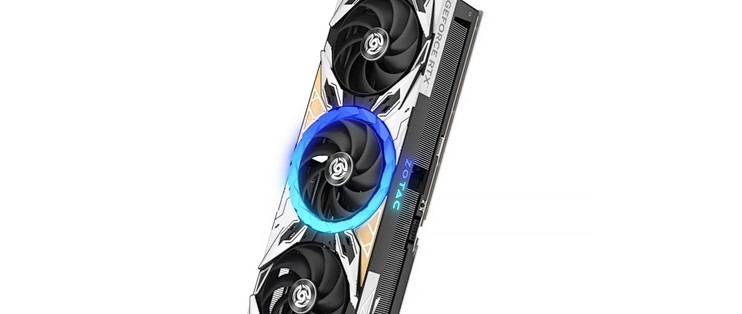

最近打算装机的朋友，我劝你先把钱包按住，听我算一笔账。

事情是这样的：RTX 50 系显卡在 10 月中下旬[连续涨了 11 个交易日](https://3g.china.com/act/news/10000169/20261103/49836076.html)，华强北一度「一日一价」，RTX 5080 渠道价冲到近 2 万，5090 系被炒到 5 万以上，商户连报价单都「写不了」。然后从 10 月底开始掉头，连跌了一周多。11 月 4 日，[RTX 5080 的全网最低价跌破了 1.4 万](https://post.m.smzdm.com/p/a6z4gx8e/)——九天前这个数字还是 19499 元。

*图源：中华网科技《RTX 50 系连续 11 个交易日上涨》*

一涨一跌，6011 元没了。看着很爽对吧？问题是，这轮下跌跌掉的只是恐慌性溢价的水分，**真正的账还远没有还清。**

## 先把账摊开

拿 11 月 4 日的全网最低价和国行首发价对比，差距是这样的：

| 型号 | 最低价 | 首发价 | 溢价 |
|---|---|---|---|
| RTX 5090D 32GB | 41599 元 | 16499 元 | +152% |
| RTX 5080 16GB | 13488 元 | 8299 元 | +62.5% |
| RTX 5070 Ti 16GB | 11288 元 | 6299 元 | +79.2% |
| RTX 5070 12GB | 7349 元 | 4599 元 | +59.8% |
| RTX 5060 Ti 16GB | 5549 元 | 3599 元 | +54.2% |
| RX 9070 XT 16GB | 5999 元 | 4999 元 | +20% |

数据来自[显卡日报的价格对账](https://post.m.smzdm.com/p/a6z4gx8e/)，全系平均溢价率从高点 94% 回落到 64.66%。也就是说，5080 跌了六千块，你买它还是要比首发价多掏五千多。5090D 更夸张，跌掉一万，还剩两万五的账。

这就是这轮行情最迷惑人的地方：**跌得狠，不代表亏得少。** 你比首发价多付的那部分，才是价格回归时要还的账。

*图源：什么值得买《显卡日报：RTX 5080 全网最低价跌破 1.4 万》*

## 涨价的根子不在显卡厂

很多人把这轮涨价归咎于黄牛和渠道封仓惜售——确实有这因素，华强北商户自己也承认「现在这个行情，让我们卖我们也不想卖」。但根子在上游。

这轮涨价的传导链很清晰：AI 数据中心对 HBM 的需求爆发，存储原厂把七八成新增产能转向 HBM 和服务器 DRAM，消费级的 GDDR 产能被持续挤占，[原厂对英伟达的显存报价一路上调](https://www.stcn.com/article/detail/4060874.html)，而板卡厂不能绕开英伟达自己买便宜显存，中间没有任何缓冲，成本直接砸进套装价。GDDR7 的报价比 GDDR6 更凶，所以 50 系涨得比 A 卡猛——RX 9070 XT 只溢价 20%，9070 GRE 甚至低于首发价，就是这个原因。

内存这边更惨烈：[DDR5 16G×2 套条最低报价 1974 元](https://news.zol.com.cn/1267/12674030.html)，去年同期大约 480 元，涨了四倍还多。CPU 反而是唯一持续走低的品类，7500F 已经杀回 599 元的历史低位。现在装机，钱全被内存和显卡吃掉了。

更要命的是，跌了几天之后，[AIC 品牌商本周又确认了新一轮提价计划](https://m.weibo.cn/detail/5361531476772969)：5090 D V2 单卡上调 2200-3300 元，5080 上调 2500-2800 元，理由除了显存荒又加了铜价上涨。行业分析认为 AMD 也可能在 11 月内跟进。这轮「回调」，随时可能被新一轮调价通知掀翻。

## 那现在到底买不买

我的建议分三种人：

**刚需（显卡坏了、机器等着用）**：只看「少亏钱」，答案其实不在 RTX 50 里。RX 9070 GRE 12GB 现在 4049 元，比首发还便宜 3.6%，跑分比 7349 元的 RTX 5070 还高一点；9070 XT 16GB 5999 元，比 5070 便宜 1350 元，1440p 和 4K 下平均快约 25%。代价是光追和 DLSS 生态、以及 CUDA 工具链——靠 CUDA 吃饭的请自动忽略这条。

**非要 N 卡**：16GB 显存 N 卡里溢价最低的是 5060 Ti 16GB。真正该避开的是 5070 Ti——比首发贵 79%，只比 5080 便宜 2200 元，溢价反而高 17 个百分点，两头不讨好。至于 8GB 版的 5060 Ti，省 550 元买一张会被显存先卡死的卡，这笔账不用我帮你算。

**不急的**：等。两个变量值得盯——5080 24GB 版本能不能在 1 月发布（台媒说英伟达 10 月底还没给 AIC 设计资料，悬），以及 DRAM 现货价格的方向。业内的判断是 DRAM 供需紧张至少延续到 2027 年，实质回落要等新增产能投放。换句话说，这不会是最后一轮过山车。

## 一句大实话

这轮行情里最委屈的其实是普通装机党：游戏没多玩几个，装机的钱先翻了一倍。AI 挤兑算力，最后埋单的是玩游戏的——这逻辑荒诞，但真实发生了。如果你的老卡还能再战半年，我真心建议再战半年。等这一轮把 HBM 的产能账还完，比现在追一张溢价 60% 的卡划算得多。

---

**快讯三条：**

- Valve 10 月 Steam 硬件调查：[RTX 3060 重夺最常见显卡位置（3.62%）](https://finance.sina.com.cn/tech/roll/2026-11-04/doc-inixqsyv0022467.shtml)，RTX 5070 占比回落 2.3 个百分点，主因是中文区样本占比下降。
- 中国渠道 RTX 50 系库存售罄，[部分厂商开始向经销商重新推荐 RTX 3060/3050 等老型号](https://finance.sina.com.cn/tech/roll/2026-11-04/doc-inixqsyv0022467.shtml)，渠道预计老卡不降反升。
- 处理器全线逼近历史低位：Ultra 7 270K Plus 散片 1859 元、9950X 散片 2707 元（[行情详情](https://news.zol.com.cn/1267/12674030.html)），CPU 是当前装机唯一「正常」的大件。

## 参考来源

- [中华网科技：RTX 50 系显卡连续 11 个交易日上涨](https://3g.china.com/act/news/10000169/20261103/49836076.html)
- [什么值得买：显卡日报，RTX 5080 最低价跌破 1.4 万](https://post.m.smzdm.com/p/a6z4gx8e/)
- [证券时报：存储原厂上调对英伟达显存报价](https://www.stcn.com/article/detail/4060874.html)
- [中关村在线：内存/CPU 装机行情](https://news.zol.com.cn/1267/12674030.html)
